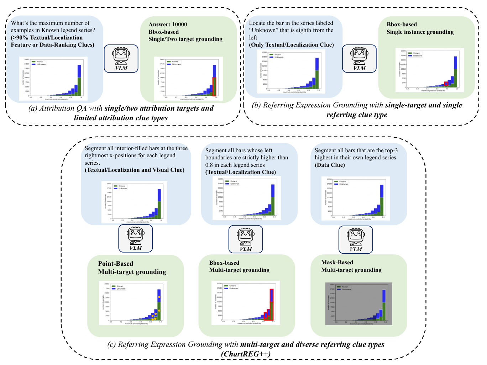
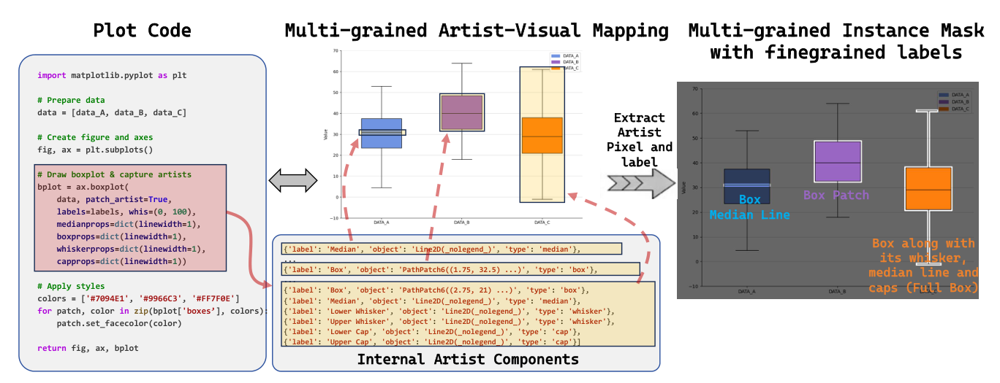

# ChartREG++

**Benchmarking and Improving Chart Referring Expression Grounding under Diverse Referring Clues and Multi-Target Referring**

[Paper](https://aclanthology.org/2026.emnlp-main.1485.pdf) | [Repository](https://github.com/nth2000/ChartREG)

ChartREG++ studies grounding natural-language expressions to chart elements using points, bounding boxes, and segmentation masks. It also introduces an LLM-free pipeline that derives instance masks from executable Matplotlib code and its Artist hierarchy.


## Benchmark

The benchmark contains **850 chart images**, **3.4K referring expressions**, and **18 element types**, with an average of **9.7 targets per expression**. Referring clues cover textual/localization, data, and visual features, including combinations of these clues.



## Mask Synthesis Pipeline

The pipeline captures plotting API returns, maps Artists to semantic chart components, and extracts masks through controlled rendering and pixel differencing. It supports bars, scatter points, line series and markers, errorbars, histograms, boxplots, filled polygons, filled bands, stacked areas, pie wedges, and treemaps, including supported polar variants.



Both figures are reproduced from the linked paper (Figures 1 and 2).

### Quick Start

Use Python 3.10+ and run these commands from the repository root:

```bash
pip install -r requirements.txt
python get_seg_mask_bbox_clean.py examples/chart.py --output extracted_instances
```

Outputs include the original chart, binary instance masks, visualization overlays, and `annotations.json` with pixel areas and inclusive `xyxy` bounding boxes. Add `--union` to merge masks within each class.

To extract only the marked bars selected in the example:

```bash
python get_seg_mask_bbox_clean.py examples/chart.py --selection examples/selection.json --ref-type vertical_bar --output selected_instances
```

Run `python -m unittest discover -s tests -v` for regression tests. See [usage details](docs/USAGE.md) for the Python API and selection format. Input scripts are executed as Python; use trusted scripts and keep their figure open until extraction finishes.

## Citation

```bibtex
@inproceedings{niu-etal-2026-chartreg,
  title = {{ChartREG++}: Benchmarking and Improving Chart Referring Expression Grounding under Diverse referring clues and Multi-Target Referring},
  author = {Niu, Tianhao and Han, Ziyu and Dong, Xuan and Zhu, Qingfu and Che, Wanxiang},
  booktitle = {Proceedings of the 2026 Conference on Empirical Methods in Natural Language Processing},
  year = {2026},
  pages = {33945--33969},
  url = {https://aclanthology.org/2026.emnlp-main.1485/}
}
```
